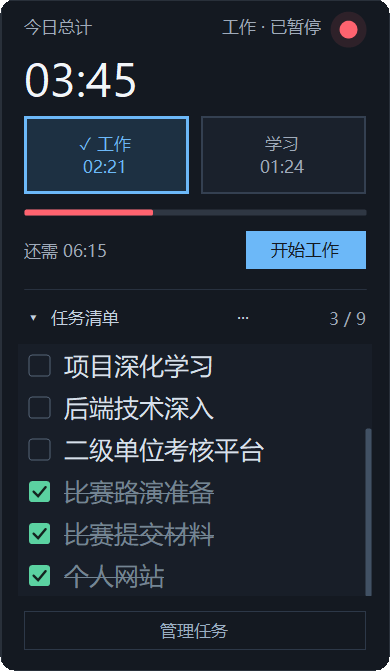
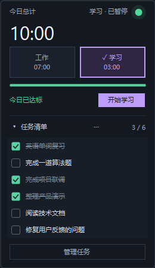
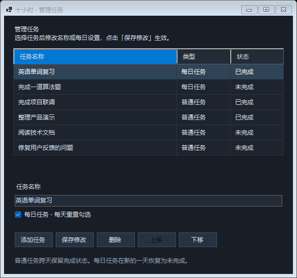
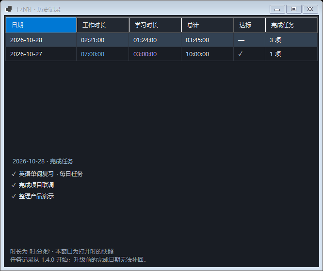

# 10 Hours — 有限制的自由

[简体中文](README.md) · [English](README.en.md)

> **自由不是想做什么就做什么，而是在拥有选择权之后，依然能够主动选择自己认可的约束。**

一个常驻桌面的十小时倒计时 App。

它的规则很简单：**每天累计投入 10 小时有效的工作与学习时间。未达标，红灯；达标，绿灯。**

<p align="center">
  
</p>

<p align="center">
  <a href="https://github.com/Limaoyu-007/TenHours/releases/latest">下载 Windows 版</a> ·
  <a href="#界面预览">查看界面</a> ·
  <a href="README.en.md">Read in English</a>
</p>

## 为什么做这个项目？

我有比许多同学更自由的时间：可以自己决定什么时候学习、什么时候开发项目、什么时候结束一天的工作。

但自由也有另一面。

有时明明还有充足的时间，做了几个小时就觉得“今天已经干得不错了”，于是心安理得地收工。

问题不一定是缺少时间，而是**当停止永远是一个选项时，人很容易提前满足。**

这让我重新思考自由的意义。

我不希望重新把时间交给外界安排，也不希望因为没有外界要求，就放任自己的时间变得松散。

所以，我给自己的自由加了一条规则：

**每天，工作与学习累计达到 10 小时。**

我拥有决定做什么的自由，但也愿意为自己认定的重要事情，承担持续投入的责任。

## 有限制的自由

所谓「有限制的自由」，不是失去选择，而是**先拥有选择，再主动决定如何使用选择权**。

我可以今天只工作几个小时，也可以随时下班；但我选择用十小时作为自己每天的投入标准。

这十小时不要求始终做同一件事。它可以是开发项目、学习技术、研究问题、阅读文档、练习算法，或其他真正推进目标的工作与学习。

**重要的不是把一天熬满，而是把十小时认真地用出去。**

## 这个 App 做什么？

- **十小时目标**：记录当天累计的工作与学习时间，直至达到 10 小时。
- **红绿灯反馈**：红灯代表今天尚未达标；绿灯代表今天的承诺已经兑现。
- **桌面常驻**：以小巧的悬浮窗呈现，让今天的进度始终可见。
- **简单直接**：不把自己变成复杂的任务管理系统，只专注一件事——今天是否完成了十小时。

计时是工具，不是目的。它用来记录真实投入，而不是制造好看的数字。

## 我给自己的约定

1. **每天累计 10 小时**：工作与学习时间合并计算。
2. **只记录有效投入**：吃饭、娱乐和普通休息不计入。
3. **完成任务不等于提前下班**：阶段性工作结束后，可以继续学习或研究值得投入的问题。
4. **十小时是达标线，不是上限**：达标以后，可以选择继续，也可以正式收工。
5. **规则由我主动设定**：它的意义是帮助我兑现自己的决定，而不是让数字代替判断。

## 最后

从前，我需要努力争取自由支配时间的权利。

现在，我开始学习另一件事：

**在已经拥有自由之后，主动给自己设定边界。**

红灯亮着，继续投入。

绿灯亮起，兑现承诺。

**自由是我拥有的权利，十小时是我主动做出的选择。**

---

Native C# / .NET 10 / WinForms. Local data, no accounts, no network.

## 界面预览

### 工作与学习分开，十小时共同达标

<p align="center">
  
  
</p>

左图是实际使用截图；右图是实际原生窗口使用示例数据展示的达标状态。工作、学习各自记账，达标后仍可继续累计。

### 单独管理任务

<p align="center">
  
</p>

任务清单负责提醒，做完打勾即可。添加、编辑、删除、排序和每日任务设置集中在一个独立窗口中。

### 回看时间，也回看完成了什么

<p align="center">
  
</p>

任务管理、历史与达标截图均由实际 WinForms 窗口生成，使用隔离的示例数据；界面当前为简体中文，英文项目介绍见 [English README](README.en.md)。

## 下载运行

直接下载 [Windows x64 · v1.5.1](https://github.com/Limaoyu-007/TenHours/releases/download/v1.5.1/TenHours-v1.5.1-win-x64.zip)，或前往 [Releases](https://github.com/Limaoyu-007/TenHours/releases/latest) 查看最新版本，解压后双击 `TenHours.exe`。

发布版自带 .NET 运行时，无需另装 .NET。支持 Windows 10/11 x64；首次打开默认暂停，开机自启默认关闭。升级前先从托盘菜单退出旧版，再启动新版，原有本地历史会保留。

## 功能

- **十小时目标**：工作与学习分开记账，合计满十小时从红灯变绿；达标后继续累计。
- **工作 / 学习分区**：悬浮窗提供两个明显的模式按钮，分别显示工作和学习累计时长，上方显示今日总计。工作用蓝色、学习用紫色，当前类别有勾选标记与状态提示；同一时段只计入所选类别。
- **简单任务清单**：直接显示在计时下方，点击勾选；完成项变暗并加删除线。长列表内部滚动，不撑满屏幕。
- **清单显示**：点击任务标题折叠或展开；标题旁的「···」可隐藏已完成、每日任务置顶，设置会自动保存。置顶仅影响悬浮窗，管理窗口中手动排列的顺序仍然保留。
- **任务管理**：点击底部「管理任务」或托盘同名菜单，在独立窗口添加、修改、删除及上下移动任务；修改后点击「保存修改」。右键任务也可快速编辑或删除。
- **每日任务**：按需勾选「每日任务」，每天重新完成；普通任务跨天保留完成状态。任务只负责提醒，与计时独立，不设置预计时长或自动排程。
- **桌面常驻**：无边框、圆角、始终置顶、拖动移动；不占用任务栏，记住位置。
- **系统托盘**：隐藏后继续计时，双击托盘图标恢复；再次启动程序也会恢复已有窗口。
- **时间补录**：选择日期、开始/结束时间和工作/学习类型，预览后确认加入累计。
- **本地历史**：按日期查看工作、学习、总计及达标状态；JSON 原子保存并保留上一份备份。
- **每日完成记录**：历史窗口同时显示完成任务数量，选中日期查看任务名称；每日重置、后续改名或删除不会改写过去的完成记录。
- **锁屏/休眠暂停**：接收对应 Windows 通知后结算并暂停，解锁或唤醒后手动继续。

不需要登录、云同步、浏览器、WebView、后台服务或网络连接。

## 使用

1. 先点击「工作」或「学习」，再点击「开始工作 / 开始学习」。正在计时时切换类别，会自动结算上一类并继续计入新类别；暂停时切换仍保持暂停。按钮会显示「暂停工作 / 暂停学习」。右键窗口或托盘图标可补录、查看历史、设置或退出。
2. 在任务清单中勾选完成项。同一天重启保留勾选；每日任务零点重置，退出后跨天重开也会重置。普通任务跨天保留勾选。计时每天单独重置。
3. 拖动窗口背景移动。默认宽约 260 逻辑像素，最多显示六行任务，随 Windows DPI 缩放。
4. 隐藏或 Alt+F4 仅隐藏窗口，计时继续。真正结束请选择托盘菜单「退出」。
5. 设置中可开启当前用户的开机自启，无需管理员权限；自启后保持暂停。移动 exe 后请在新位置重新开启自启。
6. 点击「任务清单」可折叠任务区；点击旁边「···」设置隐藏已完成或每日任务置顶，窗口右键与托盘的「清单显示」也能操作。隐藏后仍可在管理窗口编辑任务；关闭隐藏设置即可重新显示完成项。
7. 右键「查看历史」，选中一天，在下方查看当天完成的任务。完成记录保存打勾时的名称；同一天取消勾选会撤回当天的该条记录，跨天取消不会删除过去的记录。普通任务持续保持勾选不会每天重复记为完成。

工作与学习分别记录，总目标仍是 **工作 + 学习 = 10 小时**，不是各自十小时。工作面向实际问题和具体交付，学习面向知识与能力积累；开始前由自己选择类别。历史按日期分别展示工作时长、学习时长与总计，补录也需要选择计入哪一类。已有记录沿用原来的分类，不会自动重分。

当前版本已内置 15 项学习与工作任务，可直接勾选、改名或删除，无需准备 `tasks.txt`。升级时会一次性补齐这些任务并移除旧的三条示例；已有自定义任务、勾选状态和计时历史会保留。之后删除的任务不会在重启时重新出现。列表使用深色细滚动条，支持鼠标滚轮和拖动滑块。

升级到 1.3.0 时，已有任务默认保留为普通任务；可在管理窗口将英语单词、算法题等自行设为每日任务。普通任务完成后仍保留在清单，可随时删除。

任务完成记录从 1.4.0 开始，升级前已有的勾选状态照常保留，但不会据此猜测完成日期。旧日期显示「未记录」，升级当天的数量仅包含升级后记录的完成操作。

## 补录规则

例如今天已有两小时，再补录 `09:30–15:30`，累计变成 **八小时**。补录直接累加，重叠或重复区间也会再次累加，请在确认前检查。

支持过去日期；跨零点勾选「结束时间在次日」，自动分给两天。一次最多 24 小时，不允许未来时段或结束早于/等于开始的区间。补录不会切换当前工作/学习模式，也不自动开始或暂停计时；达到目标会同步更新绿灯。

## 数据与计时

数据保存在 `%LOCALAPPDATA%\TenHours\`，与 exe 位置无关：

| 文件 | 内容 |
| --- | --- |
| `data.json` | 计时历史、每日完成任务、模式、位置、清单显示设置、任务与勾选状态、补录记录 |
| `data.json.bak` | 上一份完整数据 |
| `data.damaged-*.json` | 自动恢复备份时保留的损坏主文件 |

没有自动删除历史的策略。备份时请先暂停并退出，再复制整个数据目录。程序不监测键鼠，也不自动判断你是否在工作；由手动开始/暂停及系统锁屏/休眠通知界定计时。

实际时长使用单调时钟计算，UI 延迟不会导致少算，系统日期用于跨日分账。合计显示 `HH:MM`；剩余时间向上取整到分钟，避免提前显示达标。正常重启保持暂停，不计算关闭期间的时间。

计时约每五秒保存，暂停、切换、补录、任务操作、锁屏、休眠、退出及日期变更立即保存。先写同目录临时文件并落盘，再原子替换主文件，保留备份。保存失败会暂停并保留内存进度，可右键重试保存。

**正常退出保留完整进度；强杀或断电可能丢失最近一次检查点后的约五秒计时，UI 被系统阻塞时可能更多。** 主文件损坏时尝试恢复备份；两份均不可读时拒绝覆盖，保留原文件。

## 从源码运行

需要 Windows 和 [.NET 10 SDK](https://dotnet.microsoft.com/download/dotnet/10.0)，不需要 Visual Studio 或第三方 NuGet 业务依赖。

```powershell
git clone https://github.com/Limaoyu-007/TenHours.git
cd TenHours
dotnet build .\TenHours.slnx -c Release
dotnet run --project .\src\TenHours.App\TenHours.App.csproj -c Release
```

发布自带运行时的单文件 exe：

```powershell
.\scripts\Publish.ps1
# ARM64 可选，需在目标设备另行验证
.\scripts\Publish.ps1 -Runtime win-arm64
```

输出到 `artifacts/win-x64/TenHours.exe`。自带运行时会增大磁盘文件；原生库首次运行会解压到 .NET 临时缓存，磁盘大小不等于常驻内存。未启用 WinForms 不支持的裁剪。

## 验证

```powershell
dotnet run --project .\tests\TenHours.Tests\TenHours.Tests.csproj -c Release
.\scripts\Verify.ps1
```

核心回归覆盖计时、跨日、补录、损坏恢复和清单持久化；UI 探针在实际原生窗口中检查按钮、清单、保存及系统消息路径，使用隔离数据。覆盖内容、采样方式和真实锁屏/休眠、长时间运行的验证边界见 [验证说明](docs/VALIDATION.md)。

## 项目结构

```text
src/TenHours.Core/       单调计时、每日记录、清单数据、JSON 原子保存
src/TenHours.App/        原生悬浮窗、清单、托盘、补录、历史及系统事件
tests/TenHours.Tests/   不依赖第三方测试框架的行为回归
scripts/Publish.ps1      单文件发布
scripts/Verify.ps1       编译、回归及原生窗口验证
docs/images/           实际窗口截图（示例数据）
```

## 版本

- **1.5.1**：新增中英文项目介绍、实际使用截图和任务管理、历史、达标状态展示；应用功能沿用 1.5.0。
- **1.5.0**：明显的工作 / 学习切换按钮、独立时长与今日总计，当前类别高亮，补录明确提示分类。
- **1.4.0**：隐藏已完成、每日任务置顶、折叠任务区，按日期保留完成任务并在历史中查看。
- **1.3.0**：独立任务管理窗口，添加、编辑、删除、排序与每日任务跨天重置。
- **1.2.1**：深色细滚动条，内置 15 项任务并兼容旧清单。
- **1.2.0**：计时器下方的任务清单、勾选持久化、简单编辑与视觉打磨。
- **1.1.0**：工作/学习时间补录。
- **1.0.0**：十小时计时、红绿灯、托盘、本地历史与原子保存。
