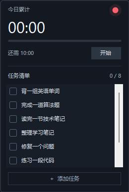
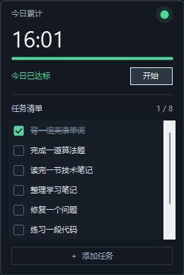

# TenHours · 十小时

一个安静的 Windows 桌面悬浮计时器：每天工作与学习累计十小时，下面放一张简单的任务清单。

**上面计时，下面列任务，做完打勾。**

A small, always-on-top Windows timer with a simple checklist. Native C# / .NET 10 / WinForms. Local data, no accounts, no network.

<p>
  
  
</p>

截图来自实际 WinForms 窗口，使用示例任务与模拟时间。

## 下载运行

前往 [Releases](https://github.com/Limaoyu-007/TenHours/releases/latest)，下载 Windows x64 压缩包，解压后双击 `TenHours.exe`。

发布版自带 .NET 运行时，无需另装 .NET。支持 Windows 10/11 x64；首次打开默认暂停，开机自启默认关闭。升级前先从托盘菜单退出旧版，再启动新版，原有本地历史会保留。

## 功能

- **十小时目标**：工作与学习分开记账，合计满十小时从红灯变绿；达标后继续累计。
- **简单任务清单**：直接显示在计时下方，点击勾选；完成项变暗并加删除线。长列表内部滚动，不撑满屏幕。
- **任务管理**：点击底部「管理任务」或托盘同名菜单，在独立窗口添加、修改、删除及上下移动任务；修改后点击「保存修改」。右键任务也可快速编辑或删除。
- **每日任务**：按需勾选「每日任务」，每天重新完成；普通任务跨天保留完成状态。任务只负责提醒，与计时独立，不设置预计时长或自动排程。
- **桌面常驻**：无边框、圆角、始终置顶、拖动移动；不占用任务栏，记住位置。
- **系统托盘**：隐藏后继续计时，双击托盘图标恢复；再次启动程序也会恢复已有窗口。
- **时间补录**：选择日期、开始/结束时间和工作/学习类型，预览后确认加入累计。
- **本地历史**：按日期查看工作、学习、总计及达标状态；JSON 原子保存并保留上一份备份。
- **锁屏/休眠暂停**：接收对应 Windows 通知后结算并暂停，解锁或唤醒后手动继续。

不需要登录、云同步、浏览器、WebView、后台服务或网络连接。

## 使用

1. 点击「开始 / 暂停」。右键窗口或托盘图标切换工作/学习模式、补录、查看历史、设置或退出。
2. 在任务清单中勾选完成项。同一天重启保留勾选；每日任务零点重置，退出后跨天重开也会重置。普通任务跨天保留勾选。计时每天单独重置。
3. 拖动窗口背景移动。默认宽约 260 逻辑像素，最多显示六行任务，随 Windows DPI 缩放。
4. 隐藏或 Alt+F4 仅隐藏窗口，计时继续。真正结束请选择托盘菜单「退出」。
5. 设置中可开启当前用户的开机自启，无需管理员权限；自启后保持暂停。移动 exe 后请在新位置重新开启自启。

当前版本已内置 15 项学习与工作任务，可直接勾选、改名或删除，无需准备 `tasks.txt`。升级时会一次性补齐这些任务并移除旧的三条示例；已有自定义任务、勾选状态和计时历史会保留。之后删除的任务不会在重启时重新出现。列表使用深色细滚动条，支持鼠标滚轮和拖动滑块。

升级到 1.3.0 时，已有任务默认保留为普通任务；可在管理窗口将英语单词、算法题等自行设为每日任务。普通任务完成后仍保留在清单，可随时删除。

## 补录规则

例如今天已有两小时，再补录 `09:30–15:30`，累计变成 **八小时**。补录直接累加，重叠或重复区间也会再次累加，请在确认前检查。

支持过去日期；跨零点勾选「结束时间在次日」，自动分给两天。一次最多 24 小时，不允许未来时段或结束早于/等于开始的区间。补录不会切换当前工作/学习模式，也不自动开始或暂停计时；达到目标会同步更新绿灯。

## 数据与计时

数据保存在 `%LOCALAPPDATA%\TenHours\`，与 exe 位置无关：

| 文件 | 内容 |
| --- | --- |
| `data.json` | 历史、模式、位置、任务与勾选状态、补录记录 |
| `data.json.bak` | 上一份完整数据 |
| `data.damaged-*.json` | 自动恢复备份时保留的损坏主文件 |

没有自动删除历史的策略。备份时请先暂停并退出，再复制整个数据目录。程序不监测键鼠，也不自动判断你是否在工作；由手动开始/暂停及系统锁屏/休眠通知界定计时。

实际时长使用单调时钟计算，UI 延迟不会导致少算，系统日期用于跨日分账。合计显示 `HH:MM`；剩余时间向上取整到分钟，避免提前显示达标。正常重启保持暂停，不计算关闭期间的时间。

计时约每五秒保存，暂停、切换、补录、任务操作、锁屏、休眠、退出及日期变更立即保存。先写同目录临时文件并落盘，再原子替换主文件，保留备份。保存失败会暂停并保留内存进度，可右键重试保存。

**正常退出保留完整进度；强杀或断电可能丢失最近一次检查点后的约五秒计时，UI 被系统阻塞时可能更多。** 主文件损坏时尝试恢复备份；两份均不可读时拒绝覆盖，保留原文件。

## 从源码运行

需要 Windows 和 [.NET 10 SDK](https://dotnet.microsoft.com/download/dotnet/10.0)，不需要 Visual Studio 或第三方 NuGet 业务依赖。

```powershell
git clone https://github.com/Limaoyu-007/TenHours.git
cd TenHours
dotnet build .\TenHours.slnx -c Release
dotnet run --project .\src\TenHours.App\TenHours.App.csproj -c Release
```

发布自带运行时的单文件 exe：

```powershell
.\scripts\Publish.ps1
# ARM64 可选，需在目标设备另行验证
.\scripts\Publish.ps1 -Runtime win-arm64
```

输出到 `artifacts/win-x64/TenHours.exe`。自带运行时会增大磁盘文件；原生库首次运行会解压到 .NET 临时缓存，磁盘大小不等于常驻内存。未启用 WinForms 不支持的裁剪。

## 验证

```powershell
dotnet run --project .\tests\TenHours.Tests\TenHours.Tests.csproj -c Release
.\scripts\Verify.ps1
```

核心回归覆盖计时、跨日、补录、损坏恢复和清单持久化；UI 探针在实际原生窗口中检查按钮、清单、保存及系统消息路径，使用隔离数据。覆盖内容、采样方式和真实锁屏/休眠、长时间运行的验证边界见 [验证说明](docs/VALIDATION.md)。

## 项目结构

```text
src/TenHours.Core/       单调计时、每日记录、清单数据、JSON 原子保存
src/TenHours.App/        原生悬浮窗、清单、托盘、补录、历史及系统事件
tests/TenHours.Tests/   不依赖第三方测试框架的行为回归
scripts/Publish.ps1      单文件发布
scripts/Verify.ps1       编译、回归及原生窗口验证
docs/images/           实际窗口截图（示例数据）
```

## 版本

- **1.3.0**：独立任务管理窗口，添加、编辑、删除、排序与每日任务跨天重置。
- **1.2.1**：深色细滚动条，内置 15 项任务并兼容旧清单。
- **1.2.0**：计时器下方的任务清单、勾选持久化、简单编辑与视觉打磨。
- **1.1.0**：工作/学习时间补录。
- **1.0.0**：十小时计时、红绿灯、托盘、本地历史与原子保存。
